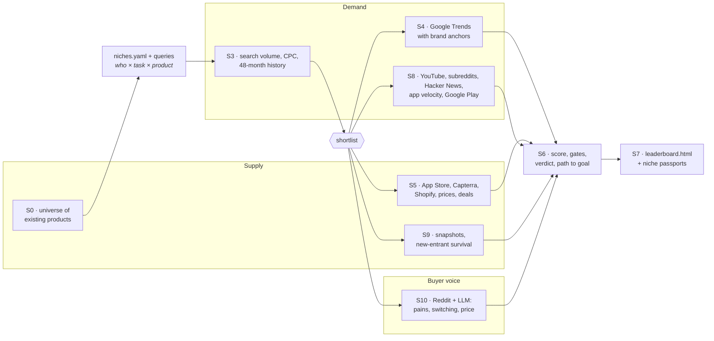

<h1 align="center">niche-finder</h1>

<p align="center">
  <b>Find software niches worth entering with a small team, using data instead of hunches.</b>
</p>

<p align="center">
  <a href="https://github.com/tinthefounder/niche-finder/actions/workflows/ci.yml"></a>
  <a href="LICENSE"></a>
  
</p>

<p align="center">
  <a href="#quick-start">Quick start</a> ·
  <a href="#how-it-works">How it works</a> ·
  <a href="#what-you-get">What you get</a> ·
  <a href="#how-a-niche-turns-green">Verdicts</a> ·
  <a href="#keys-and-costs">Keys and costs</a> ·
  <a href="docs/methodology.md">Methodology</a>
</p>

---

Search volume alone lies: a query can grow because Google changed how it counts, a "huge market" can belong to one free app, and a crowded market can still have room. **niche-finder** measures each niche from several independent sources and only calls it green when they agree.

You describe niches as **who × task × product**:

```yaml
- id: pet-care-facilities
  name: Pet boarding, grooming and daycare — booking and operations
  who: pet boarding / daycare / grooming / training businesses, 1–20 people
  task: booking, pet records (vaccinations), payments, communication with owners
  product: web SaaS, $50–150/month
```

The pipeline then answers, for every niche:

| Question | Measured with |
|---|---|
| **Do people search for it, and is that growing?** | Google Ads volume, CPC and 4 years of history (DataForSEO), Google Trends with brand anchors, autocomplete |
| **Is supply fragmented, or does one player own it?** | App Store ratings, Google Play installs, Capterra and Shopify App Store reviews: leader's share, number of real players |
| **Do customers pay?** | In-app purchase prices, B2B list prices, top-grossing charts, businesses sold with a verified P&L (Empire Flippers), TinySeed, YC, Product Hunt |
| **Is there demand outside search?** | YouTube interest, subreddit activity, Hacker News launches and questions, startup job postings, how fast new apps gain ratings, whether new entrants survive |
| **What do buyers complain about?** | Reddit posts and comments classified by an LLM: who is looking for a tool, who is switching from what to what, price objections, with quotes |
| **Can it reach my income goal?** | Paying customers needed for your target net income, and what share of the niche that is |

> **Screening is not validation.** The pipeline tells you where to look and what buyers complain about. Whether they will pay for *your* version is only answered by talking to them and shipping. See [what it cannot prove](docs/methodology.md#10-what-the-pipeline-proves-and-what-it-cannot).

## Quick start

```bash
git clone https://github.com/tinthefounder/niche-finder
cd niche-finder
python -m venv .venv && source .venv/bin/activate     # Windows: .venv\Scripts\activate
pip install -e ".[trends]"

nf init ../my-research        # a workspace with an example catalog of 165 niches
cd ../my-research
# add your keys to .env — all optional, see "Keys and costs"
nf doctor                      # what is ready and what is missing
nf validate                    # check niches.yaml and queries/
nf run all                     # stages without a key or tool are skipped, not failed
```

Then open `reports/leaderboard.html`.

Prefer a screen to a terminal? `nf ui` opens a local console in the browser: pick the markets, niche segment and tiers, pick the stages, press Run and watch each stage go from pending to running, done, skipped or failed with its live output, then read the scores and reports of that run.

<details>
<summary>More commands</summary>

```bash
nf list                        # every stage, in run order, with readiness
nf run s3                      # one group
nf run s5_capterra -- --help   # one stage with its own flags
nf run s9_snapshot -- freeze   # freeze supply today; later: refresh, then diff
nf profile west-b2b --markets us,ww --side b2b-smb,b2b-mid   # a filtered run with its own outputs
nf -p west-b2b run all         # run under that profile
nf ui                          # the local web console (http://127.0.0.1:8765)
nf setup node                  # install the Google Play scraper for Node-based stages
```

</details>

## How it works



Every stage is a separate command. Every external response is cached in the workspace, so re-running anything is free and works offline. The cheap quick filter (S3) decides which niches get the expensive deep measurements.

| Group | What it does |
|---|---|
| `s0` | Universe of existing products: App Store top-grossing, Google Play, Product Hunt, YC, Empire Flippers, TinySeed, WordPress.org, Shopify App Store, BetaList, Product Radar (Russian launches), Kickstarter |
| `s1` | Niche catalog report; coverage: how much of the universe your niches explain |
| `s2` | Query validation with autocomplete (Wordstat for Russia) |
| `s3` | Search demand quick filter and an automatic shortlist |
| `s4` | Trend depth: Google Trends with broad and brand anchors |
| `s5` | Supply depth: App Store, Capterra, Shopify; pricing; businesses for sale |
| `s8` | Demand outside search: YouTube, subreddits, app velocity, Google Play, hh.ru, Hacker News (Show HN, Ask HN, "Who is hiring?") |
| `s9` | Supply over time: snapshots and diffs, new-entrant survival |
| `s10` | Buyer voice from Reddit |
| `s6` | Score, gates, verdicts, path to goal, passports |
| `s7` | HTML leaderboard |
| `info` | Separate cohort for micro info products sold through short video and Telegram: topics by Wordstat demand (topic-free intent words, LLM-sorted), YouTube autocomplete ideas, Shorts metrics (views, room for newcomers, Telegram funnels, offers), its own score and report |
| `ru` | Optional Russian B2B module: software registry, public procurement, Bitrix24 Market, hh.ru, Wordstat |

Inputs, outputs, keys and cost of each of the 63 stages: [docs/stages.md](docs/stages.md).

## What you get

| Output | Inside |
|---|---|
| `reports/leaderboard.html` | One self-contained page: every niche with score, verdict, demand, supply, prices, Reddit verdict and path-to-goal grade; filters, sorting, and the passport of each niche on click |
| `reports/passports/<niche>.md` | A one-page brief per niche, in the sections shown below |
| `reports/S3-quick-filter.md` | Search demand for all niches, gates, data-quality flags, the shortlist |
| `reports/S10-reddit-voice.md` | Pain themes with quotes, switching map ("from X to Y"), brand share of voice |
| `reports/S0-kickstarter.md` | Kickstarter subcategories by money pledged in the last 12 months, success rates, top projects |
| `reports/S6-path-to-goal.md` | Price, paying customers needed, share of the niche, required position, grade |
| `data/out/*.csv` | Every measurement as a table, for your own analysis |

A passport reads top to bottom like this:

```
Pet boarding, grooming and daycare — booking and operations
verdict · score · gates passed / failed · flags

Demand            volume, CPC, growth in two windows, Trends verdict, brand cross-check
Supply            players with real traction, leader's share, new entrants and their survival
Prices            list prices, monthly vs annual, free-plan share
Off-search        YouTube, subreddits, Google Play installs, rating velocity
Buyer voice       pain themes with quotes, who people switch from and to, price objections
Path to goal      price → payers needed → share of the niche → position you would need
```

## How a niche turns green

A niche that fails any gate is **red**. One that passes all gates is **green** when its score reaches `verdict.green_min_score` (70 by default) and **yellow** otherwise. You can set the verdict by hand for niches that pass, in `config/overrides.yaml`.

| Gate | Passes when |
|---|---|
| **G0 data** | at least 3 category queries have search volume |
| **G1 trend** | demand is not declining (Keyword Planner and Trends, with contamination checks) |
| **G2 monopolist** | the top brand holds at most 50 % of brand searches |
| **G3 platform** | no free built-in feature of a platform (iOS, Google, Shopify…) already does the job |
| **G4 expertise** | it does not need a medical, legal or financial licence |
| **G5 feasibility** | at least 2 of 4 small-team signals: indie players exist, commodity stack, no regulated data, self-serve sales |
| **S5 supply** | an independent count shows fragmentation: leader ≤ 50 % and ≥ 8 players with real traction, on at least one platform |

The score (0–100) adds demand 30, growth 20, fragmentation 25, deals 15 and ease of switching 10. Components are percentiles within the B2C or B2B cohort, then a small bonus or penalty is applied for the trend. No machine learning: every number can be checked by hand. Full formulas: [methodology](docs/methodology.md#7-gates-and-the-score).

## Keys and costs

Every key is optional. A stage whose key is missing is skipped with a message saying where to get it. Keys are read from the environment or from `<workspace>/.env`, never from configs.

| Key | Unlocks | Cost |
|---|---|---|
| `DATAFORSEO_LOGIN`, `DATAFORSEO_PASSWORD` | Search volume, CPC and 48-month history (S3) | Pay-as-you-go; about $0.09 per request of up to 1,000 keywords per location |
| `LLM_API_KEY` (+ `LLM_BASE_URL`, `LLM_MODEL`) | Reddit classification (S10); any OpenAI-compatible endpoint | With DeepSeek, about $0.5 for 8,000 posts and comments |
| `YANDEX_API_KEY` | Wordstat (Russian module) | Free quota of 100 requests per hour |
| `YOUTUBE_API_KEY` | Short-video metrics for the info cohort (`info_youtube`) | Free quota of 10,000 units per day (about 90 one-phrase topics) |
| `PRODUCTHUNT_TOKEN` | Product Hunt launches through the official API (`s0_producthunt`) | Free developer token; a complexity limit per 15 minutes |

Everything else is free: iTunes Search and RSS, Google Play (through Node), Google Trends (through `trendspy`), autocomplete, WordPress.org, Shopify App Store, Capterra and GetApp pages, the Arctic Shift Reddit archive, YC, Empire Flippers (JSON API), TinySeed, BetaList, Product Radar, Kickstarter (Web Robots dumps), Hacker News (Algolia API).

Optional tools: Node.js 18+ for Google Play stages (`nf setup node`), and `curl` for sites that refuse Python clients.

## Your workspace

A workspace is a folder with `nf.yaml`. Your data lives there, never in this repository.

```
my-research/
├── nf.yaml          markets (us / ww / ru), income goal, verdict threshold, LLM, as-of date
├── .env             your keys
├── niches.yaml      the niches to measure
├── queries/         search queries per niche: category / problem / brand, one anchor per language
├── config/          source maps, relevance exclusions, overrides, scoring weights
├── data/
│   ├── cache/       every external response: re-runs are free and work offline
│   └── out/         every measurement as CSV / JSON
├── reports/         leaderboard.html, passports, stage reports
├── profiles/<name>/ filtered runs: profile.yaml, their own data/out/ and reports/
└── logs/ui/         run history of nf ui
```

Set `as_of: YYYY-MM-DD` in `nf.yaml` to reproduce an earlier run from cache.

**Your own niches.** Edit `niches.yaml` and add queries for each niche in `queries/`; `nf validate` tells you what is missing. `config/overrides.yaml` holds the human judgments the gates need: platform risk, lock-in and feasibility.

**The shortlist.** Deep stages (S4, S5, S8, S9) measure only shortlisted niches. `s3_report` writes `config/shortlist.yaml` from search demand on the first run and never overwrites it after that. Niches whose evidence is on the supply side, such as an app-store category with many small paid players, can have low search demand. Add those by hand.

**Your goal.** `goal` in `nf.yaml` sets the net monthly income you are aiming for, in any currency. The path-to-goal grade A also requires a founder fit of 2 or more. Fit defaults to `default_fit: 1`; set `fit` per niche in `config/overrides.yaml` where your skills or stack carry over.

**Markets.** `markets: [us, ww]` measures the US and worldwide demand pools. Adding `ru` enables the Russian module. Some Russian sources refuse foreign IP addresses: set `NF_PROXY_RU` to route only those requests through a proxy. `HTTPS_PROXY` applies to everything.

**Filtered runs.** A run profile measures part of the catalog: only the western markets, only Russia, only B2B niches, only some tiers. Its outputs and reports go to `profiles/<name>/`, so the full leaderboard stays as it is, while settings, config, keys, raw dumps and the cache are shared, so a profile never pays twice for a call the full run made. A new profile starts from a copy of the full run's `data/out/` for its niches, which lets it rescore (S6, S7) at once. Percentiles are taken within the B2B or B2C segment, so a B2B-only profile gives the same B2B scores as the full run; a profile without the `us` market has no demand signal in the S6 score, so read the Russian leaderboard (`s6_ru`) there.

## Documentation

| Document | For |
|---|---|
| [docs/methodology.md](docs/methodology.md) | Why each stage exists, known data traps, gates, score formula, path to goal, what the pipeline cannot prove, what to do after screening |
| [docs/stages.md](docs/stages.md) | Every stage: inputs, outputs, keys, cost |
| [docs/idea-sources.md](docs/idea-sources.md) | 49 other places to find and evaluate ideas, each probed for API access, freshness and price |

## Responsible use and known limits

Some stages read public web pages: Capterra, GetApp, the Shopify App Store, Google Play, BetaList and Product Radar. Requests are cached, spaced out and identified. Check each site's terms before you run those stages, and keep your request volume modest. You are responsible for how you use the data. This repository does not redistribute scraped data.

Sites change. Here is what is reachable today:

- **Product Hunt** web pages answer automated clients with a Cloudflare challenge, so `s0_producthunt` uses the official API with a free token. The API terms restrict commercial use without permission from Product Hunt.
- **Flippa** answers with a Cloudflare challenge too and has no API, so its stage was removed. Empire Flippers (open JSON API) replaces it in the universe and the passports, but not in the score; see methodology section 7.2.
- **G2** blocks scraping, and **Smart Ranking** has no fetcher. Both can be imported from your own CSV; see the `s0_merge` docstring.

## Contributing

Issues and pull requests are welcome. Run `pytest` before opening a PR. A new data source becomes a new stage module in `src/nichefinder/stages/`; the contract is described at the top of `stages/__init__.py`.

## License

[MIT](LICENSE)
